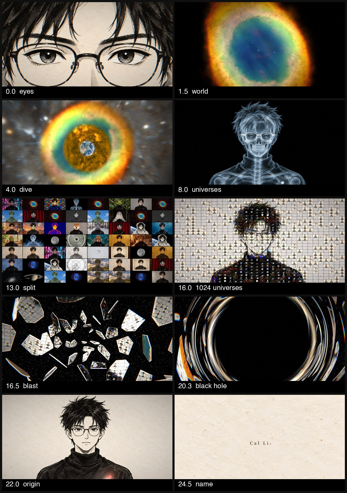
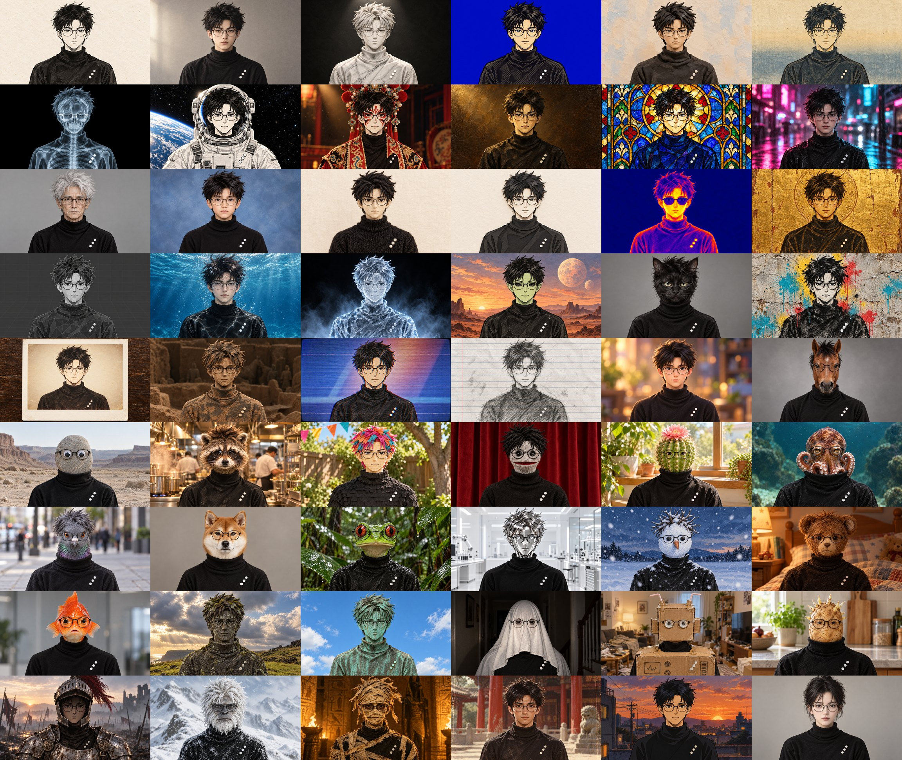

# Multiverse intro

A 27.5-second film of one character in 53 universes. No video model was used. Every frame is code, rendered from still images: 53 AI-made universes and 37 free-to-use photos from NASA and Wikimedia Commons (public domain, CC0, or no known copyright restrictions).

This folder has everything you need to make your own version with any coding agent and any image model.

**Watch the original:** _(link to the post on X)_

## What's in here

| file | what it is |
| --- | --- |
| [`PROMPT.md`](PROMPT.md) | The film, beat by beat: every effect, every number, the music and every sound cue. Paste it into a coding agent. |
| [`UNIVERSES.md`](UNIVERSES.md) | 53 image prompts, the two lock blocks that keep the pose and eyes in place, and the slots for your character. |
| [`timing.json`](timing.json) | The film's event table: every cut, portal, split and blast stage, frame by frame. |
| [`SOURCES.md`](SOURCES.md) | Every real photo, with link, license and credit. |
| `universes.jpg` | All 54 portraits (u00 to u53). |

## Make yours

1. **Portrait.** Make your `u00`: frontal, centred, chest-up, 2048×1152, on a plain background, in your style. A photo is fine.
2. **Universes.** Fill the four slots in `UNIVERSES.md` (hair, glasses, outfit, one small mark). Generate the 53 images with an image model that edits from a reference image, using `u00` as the reference.
3. **Photos.** Download public-domain or CC0 photos (ours are in `SOURCES.md`). Include eleven round things that nest inside each other, for the dive.
4. **Film.** Fill in the Inputs at the top of `PROMPT.md` and paste it into Claude Code, Codex, Cursor, Gemini CLI or another agent. The agent writes the effects and the sound, and renders the MP4.

Tip: ask the agent to build all 8 beats as plain cuts with sound first, and to add one effect at a time after that.

## What the original used

- Universes: ChatGPT image generation through the Codex CLI, with the ink portrait as the reference
- Music and sound effects: ElevenLabs (one piece of music, 20 effects), plus 7 sounds synthesised in code
- Effects: WebGL2 fragment shaders, with each frame a pure function of time
- Render: [HyperFrames](https://github.com/heygen-com/hyperframes) (headless Chrome + FFmpeg)
- Eye lock: Apple Vision face landmarks (MediaPipe works the same way)
- Paid API cost: about ¥1.2 (under $0.20) for the music and sound effects

## Inspiration

The multiverse montage in *Everything Everywhere All at Once*: the same pose and the same face position, with the universe changing faster and faster. And Kimi's K3.1 teaser: one photo per frame, slowing down, landing, holding, tearing.

## License

See the [repo README](../README.md#license). In short: the text is CC BY 4.0 (credit Cal Li), the Cal Li character and images are not licensed for reuse, and the photos keep their own licenses.
